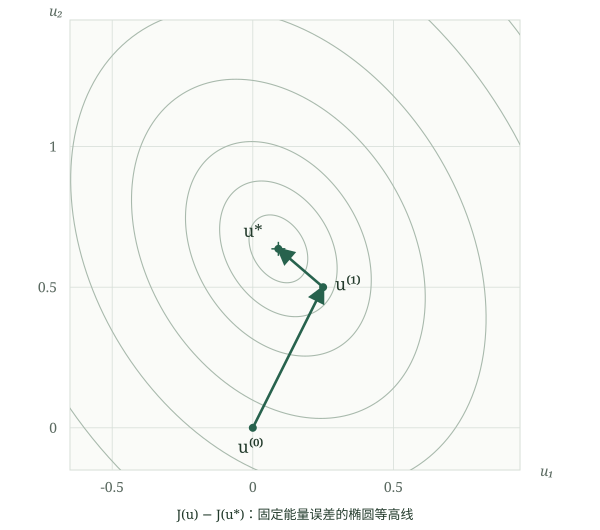

# 共轭梯度法与 Krylov 子空间：从构造到最优性

> **核心结论**：CG 不是先假设正交性，再猜出递推式。它先用精确线搜索和完整的 $A$-正交化构造共轭方向法，证明残差两两正交后，才把完整正交化化简成短递推。得到的迭代点，是逐渐扩大的 Krylov 仿射空间中的能量范数最优近似。

本文按原讲解的逻辑整理，保留 $A=\begin{pmatrix}4&1\\1&3\end{pmatrix}$ 的数值例子，并扩充 Krylov 空间、Galerkin 条件、多项式与谱的联系。讨论对象是实对称正定线性系统；除特别说明外，理论证明采用精确算术，且在当前残差非零时继续迭代。

## 1. 从线性方程组到二次优化

考虑

$$
Au=b,\qquad A\in\mathbb R^{n\times n},\quad A^T=A,\quad v^TAv>0\ (v\ne0).
$$

构造严格凸二次函数

$$
J(u)=\tfrac12u^TAu-b^Tu,\qquad \nabla J(u)=Au-b,\quad \nabla^2J=A\succ0.
$$

唯一极小点 $u_*$ 满足 $Au_*=b$。定义残差和误差为

$$
r_k=b-Au_k=-\nabla J(u_k),\qquad e_k=u_*-u_k,\qquad r_k=Ae_k.
$$

残差可由当前迭代点计算；误差需要未知的精确解，实际程序通常无法直接获得。残差是负梯度，但一般不等于误差。

| 符号 | 含义 |
| --- | --- |
| $u_k$ | 第 $k$ 个近似解 |
| $r_k$ | 残差，也是当前负梯度 |
| $p_k$ | 搜索方向，通常不是当前负梯度本身 |
| $\alpha_k$ | 沿 $p_k$ 的精确线搜索步长 |
| $\beta_k$ | 短递推中的方向修正系数 |
| $\langle x,y\rangle_A=x^TAy$ | 由 SPD 矩阵定义的内积 |

## 2. 第一步：精确线搜索自然带来正交性

从任意 $u_0$ 开始，取 $p_0=r_0$。若 $r_0=0$，已得到解；否则沿方向最小化：

$$
\alpha_0=\operatorname*{argmin}_{\alpha\in\mathbb R}J(u_0+\alpha p_0).
$$

展开后

$$
J(u_0+\alpha p_0)=J(u_0)-\alpha p_0^Tr_0+\tfrac12\alpha^2p_0^TAp_0.
$$

令关于 $\alpha$ 的导数为零：

$$
\alpha_0=\frac{p_0^Tr_0}{p_0^TAp_0}=\frac{r_0^Tr_0}{p_0^TAp_0}.
$$

更新

$$
u_1=u_0+\alpha_0p_0,\qquad r_1=r_0-\alpha_0Ap_0.
$$

于是

$$
r_1^Tp_0=r_0^Tp_0-\alpha_0p_0^TAp_0=0.
$$

因为 $p_0=r_0$，也得到 $r_1^Tr_0=0$。

> **核心结论**：新残差与刚走过的方向正交，是精确线搜索的结果。第一步得到 $r_1\perp r_0$，不等于已经证明了所有残差两两正交。

## 3. 共轭条件从哪里来？

若每次都取 $p_k=r_k$，就是最速下降法。下一次沿新梯度走时，可能破坏以前已经取得的方向最优性，导致反复修正。

我们希望更新后仍保留沿 $p_0$ 的最优性。先提出可调整的候选方向

$$
p_1=r_1+c_0p_0.
$$

若下一步为 $u_2=u_1+\alpha_1p_1$，则

$$
r_2^Tp_0=r_1^Tp_0-\alpha_1p_1^TAp_0.
$$

已有 $r_1^Tp_0=0$。为使新更新不破坏它，我们主动要求

$$
p_1^TAp_0=0.
$$

代入候选式解出

$$
c_0=-\frac{r_1^TAp_0}{p_0^TAp_0},\qquad
p_1=r_1-\frac{r_1^TAp_0}{p_0^TAp_0}p_0.
$$

这里 $A$-共轭性首先是**设计要求**；由选择系数保证之后，才成为可用于后续证明的已知事实。

普通正交与共轭是不同的：

$$
x^Ty=0\quad\text{是普通正交},\qquad x^TAy=0\quad\text{是 }A\text{-正交}.
$$

几何上，$x^TAy=(A^{1/2}x)^T(A^{1/2}y)$。共轭方向是在变换后的坐标里垂直，在原坐标中未必呈直角。

## 4. 完整的 $A$-Gram–Schmidt 构造

在第 $k$ 步，从新负梯度出发，允许使用全部旧方向：

$$
p_k=r_k+\sum_{j=0}^{k-1}c_jp_j.
$$

假设旧方向已按相同程序构造，因而彼此 $A$-共轭。要求 $p_k^TAp_j=0$，得到

$$
c_j=-\frac{r_k^TAp_j}{p_j^TAp_j},
$$

即

$$
\boxed{p_k=r_k-\sum_{j=0}^{k-1}\frac{r_k^TAp_j}{p_j^TAp_j}p_j.}
$$

这是在 $A$-内积下对 $r_k$ 做 Gram–Schmidt。现在它还是一个需要保存所有旧方向的算法，并未得到 CG 的短递推。

算法构造与证明要按以下顺序理解：

```text
完整 A-正交化：保证新旧方向共轭
          ↓
精确线搜索：证明新残差与全部已用方向正交
          ↓
残差属于已有方向的张成空间：推出残差两两正交
          ↓
较早的投影系数变为零：完整构造化简为短递推
```

## 5. 严格证明残差的 mutual orthogonality

### 5.1 先证明残差与所有旧方向正交

归纳假设在第 $k$ 步开始时

$$
r_k^Tp_j=0\qquad(j<k).
$$

基础情形 $k=0$ 没有旧方向；$k=1$ 的结论已由第一次线搜索得到。完整正交化保证 $p_k^TAp_j=0$，并且

$$
r_k^Tp_k=r_k^Tr_k+\sum_{j<k}c_jr_k^Tp_j=r_k^Tr_k.
$$

因此精确线搜索给出

$$
\alpha_k=\frac{r_k^Tr_k}{p_k^TAp_k},\qquad r_{k+1}=r_k-\alpha_kAp_k.
$$

对当前方向，

$$
r_{k+1}^Tp_k=r_k^Tr_k-\alpha_kp_k^TAp_k=0.
$$

对任意 $j<k$，

$$
r_{k+1}^Tp_j=\underbrace{r_k^Tp_j}_{0}-\alpha_k\underbrace{p_k^TAp_j}_{0}=0.
$$

归纳完成：

$$
\boxed{r_{k+1}^Tp_j=0\quad(0\le j\le k).}
$$

这也说明 $r_k\ne0$ 时 $p_k\ne0$：否则 $r_k^Tp_k=r_k^Tr_k>0$ 不可能成立。故 SPD 保证继续迭代时的分母 $p_k^TAp_k$ 为正。

### 5.2 再推出残差两两正交

由方向构造式，

$$
r_j=p_j-\sum_{i<j}c_ip_i\in\operatorname{span}\{p_0,\ldots,p_j\}.
$$

而 $r_{k+1}$ 与 $p_0,\ldots,p_k$ 全部正交，所以

$$
r_{k+1}^Tr_j=0\quad(j\le k).
$$

因此

$$
\boxed{r_i^Tr_j=0\quad(i\ne j).}
$$

**逻辑关键**：残差两两正交是“完整共轭方向构造 + 精确线搜索”的推论，没有作为前提偷偷放进步长或方向推导中。

## 6. 为什么只需保留上一个方向？

对下一步完整正交化：

$$
p_{k+1}=r_{k+1}-\sum_{j=0}^k\frac{r_{k+1}^TAp_j}{p_j^TAp_j}p_j.
$$

由残差更新可写

$$
Ap_j=\frac{r_j-r_{j+1}}{\alpha_j}.
$$

当 $j<k$ 时，$j,j+1\le k$，已经证明的残差正交性给出

$$
r_{k+1}^TAp_j=\frac{r_{k+1}^Tr_j-r_{k+1}^Tr_{j+1}}{\alpha_j}=0.
$$

因此只有最后一项保留下来：

$$
p_{k+1}=r_{k+1}+\beta_kp_k,\qquad
\beta_k=-\frac{r_{k+1}^TAp_k}{p_k^TAp_k}.
$$

再利用

$$
r_{k+1}^TAp_k=-\frac{r_{k+1}^Tr_{k+1}}{\alpha_k},\qquad
\alpha_kp_k^TAp_k=r_k^Tr_k,
$$

得到

$$
\boxed{\beta_k=\frac{r_{k+1}^Tr_{k+1}}{r_k^Tr_k}.}
$$

> **核心结论**：CG 的“两项方向递推”不是随意猜出来的形式，而是完整正交化在 SPD 二次问题和精确线搜索下的精确化简。若新残差为零，应停止，不必再构造下一个方向。

## 7. 完整算法与停止准则

```text
输入：SPD 算子 A、右端 b、初值 u、容差 atol/rtol、迭代上限
r = b - A*u
p = r
rho = dot(r,r)
tol = max(atol, rtol*norm(b))
若 norm(r) <= tol：返回 u

for k = 0, ..., maxiter-1:
    q = A*p
    d = dot(p,q)
    若 d 非正或出现非有限数：报告 SPD/数值异常
    alpha = rho/d
    u = u + alpha*p
    r = r - alpha*q
    rho_new = dot(r,r)
    若 sqrt(rho_new) <= tol：
        r_true = b-A*u
        若 norm(r_true) <= tol：返回 u
        r = r_true
        p = r
        rho = dot(r,r)
        continue（以真实残差重启）
    beta = rho_new/rho
    p = r + beta*p
    rho = rho_new

返回 u，并报告“达到上限”及真实残差
```

核心迭代每步一次矩阵向量乘法和若干内积、向量更新；不计停止验证时额外的真实残差计算。除了矩阵或算子，只需保存少量长度为 $n$ 的向量。稀疏矩阵乘法成本约为 $O(\operatorname{nnz}(A))$，不是显式形成 $A^k$。

同时给出绝对和相对容差，可处理 $b=0$ 时不能除以 $\|b\|$ 的情况。程序中的递推残差与真实残差会因舍入误差产生差距，详见第 13 节。

## 8. 原数值例子：两步得到精确解

取

$$
A=\begin{pmatrix}4&1\\1&3\end{pmatrix},\quad b=\begin{pmatrix}1\\2\end{pmatrix},\quad u_0=\begin{pmatrix}0\\0\end{pmatrix}.
$$

$A$ 对称，且顺序主子式为 $4>0$、$\det A=11>0$，所以它是 SPD。

### 8.1 第一次迭代

$$
r_0=p_0=\begin{pmatrix}1\\2\end{pmatrix},\qquad Ap_0=\begin{pmatrix}6\\7\end{pmatrix}.
$$

$$
\alpha_0=\frac5{20}=\frac14,\quad
u_1=\begin{pmatrix}1/4\\1/2\end{pmatrix},\quad
r_1=\begin{pmatrix}-1/2\\1/4\end{pmatrix}.
$$

检查 $r_1^Tr_0=-1/2+1/2=0$。因为 $r_1^Tr_1=5/16$，

$$
\beta_0=\frac{5/16}{5}=\frac1{16},\qquad
p_1=r_1+\tfrac1{16}p_0=\begin{pmatrix}-7/16\\3/8\end{pmatrix}.
$$

$$
Ap_1=\begin{pmatrix}-11/8\\11/16\end{pmatrix},\qquad p_0^TAp_1=0.
$$

注意 $p_0^Tp_1=5/16\ne0$：这两个方向共轭，但并不普通正交。

### 8.2 第二次迭代

$$
p_1^TAp_1=\frac{55}{64},\qquad \alpha_1=\frac{5/16}{55/64}=\frac4{11}.
$$

$$
u_2=u_1+\alpha_1p_1=\begin{pmatrix}1/11\\7/11\end{pmatrix},\qquad Au_2=b,\qquad r_2=0.
$$

| 迭代点 | $u_k$ | $r_k$ | $\|r_k\|_2$ |
| --- | --- | --- | --- |
| $k=0$ | $(0,0)^T$ | $(1,2)^T$ | $\sqrt5$ |
| $k=1$ | $(1/4,1/2)^T$ | $(-1/2,1/4)^T$ | $\sqrt5/4$ |
| $k=2$ | $(1/11,7/11)^T$ | $(0,0)^T$ | $0$ |

以上分数均按精确有理数复算。对应目标值为 $J(u_0)=0$、$J(u_1)=-5/8$、$J(u_*)=-15/22$。



图中每条椭圆代表固定的目标差 $J(u)-J(u_*)$；坐标轴采用相同尺度。两段路径对应两次精确线搜索，不表示搜索方向在原坐标中互相垂直。网页版本可以逐步切换 $k=0,1,2$。

## 9. Krylov 子空间：从一个向量逐层扩展

### 9.1 定义与最直接的直觉

$$
\mathcal K_m(A,r_0)=\operatorname{span}\{r_0,Ar_0,\ldots,A^{m-1}r_0\},\qquad \mathcal K_0=\{0\}.
$$

$\operatorname{span}$ 表示所有线性组合。因此

$$
\begin{aligned}
\mathcal K_1&=\{a_0r_0\},\\
\mathcal K_2&=\{a_0r_0+a_1Ar_0\},\\
\mathcal K_3&=\{a_0r_0+a_1Ar_0+a_2A^2r_0\}.
\end{aligned}
$$

第一层只能调整初始残差的倍数；第二层额外利用 $A$ 作用一次带来的信息；随后继续加入矩阵作用产生的新方向。

$$
\mathcal K_0\subseteq\mathcal K_1\subseteq\mathcal K_2\subseteq\cdots,\qquad \dim\mathcal K_m\le m.
$$

包含关系不一定严格，维数也不一定每步增加。例如若 $Ar_0=\lambda r_0$，后面的所有幂都与 $r_0$ 平行，空间始终只有一维；CG 此时一步就能消除该特征方向的误差。

> **核心结论**：Krylov 空间由 $(A,r_0)$ 共同决定。它不是“矩阵的前几列”，也不是自动与坐标轴对齐的空间；改变初值会改变 $r_0$，因而可能改变整个搜索空间。

### 9.2 在原例子里亲手算一层

$$
r_0=\begin{pmatrix}1\\2\end{pmatrix},\quad Ar_0=\begin{pmatrix}6\\7\end{pmatrix},\quad
\det\begin{pmatrix}1&6\\2&7\end{pmatrix}=-5\ne0.
$$

所以 $\mathcal K_1$ 是一条直线，$\mathcal K_2=\mathbb R^2$。第一次迭代在线 $u_0+\mathcal K_1$ 上最优；第二次已经能在整个平面寻找最优解。

同一个空间可以有不同基。本例

$$
p_1=\frac{17}{16}r_0-\frac14Ar_0,
$$

因此 $\{p_0,p_1\}$ 和 $\{r_0,Ar_0\}$ 张成同一个二维空间，但前者还具有 $A$-共轭结构。

### 9.3 为什么 CG 的方向就在这个空间里？

从 $p_0=r_0\in\mathcal K_1$ 开始，递推式依次给出

$$
Ap_k\in\mathcal K_{k+2},\quad r_{k+1}=r_k-\alpha_kAp_k\in\mathcal K_{k+2},\quad p_{k+1}\in\mathcal K_{k+2}.
$$

归纳得到 $p_k,r_k\in\mathcal K_{k+1}$。每次更新是旧方向的线性组合，所以

$$
u_k-u_0\in\operatorname{span}\{p_0,\ldots,p_{k-1}\}\subseteq\mathcal K_k.
$$

非零共轭方向线性无关：若 $\sum_jc_jp_j=0$，左乘 $p_i^TA$，便得 $c_ip_i^TAp_i=0$，从而 $c_i=0$。

只要尚未提前终止，左边张成空间的维数是 $k$；而右边 $\dim\mathcal K_k\le k$，因此

$$
\boxed{\mathcal K_k(A,r_0)=\operatorname{span}\{p_0,\ldots,p_{k-1}\}.}
$$

这是包含关系加维数论证，不是把“CG 必须使用 Krylov 基”当成先验假设。

### 9.4 为什么不直接存 $r_0,Ar_0,A^2r_0,\ldots$？

原始幂向量可能迅速变得近似线性相关：反复乘 $A$ 会放大某些特征方向，导致基底数值病态。CG 在精确算术中以同一空间的共轭基工作，并利用短递推避免保存全部历史。

算法只需要计算 $Ap_k$。定义里出现 $A^{m-1}$，不等于程序必须显式计算或存储矩阵幂。

## 10. Galerkin 条件与能量范数最优性

### 10.1 仿射搜索空间上的一阶条件

前面已证明 $r_k\perp p_j$（$j<k$），结合空间相等关系，得到

$$
u_k\in u_0+\mathcal K_k,\qquad r_k\perp\mathcal K_k.
$$

第二个条件就是这里的 Galerkin 正交条件。对任意 $v\in\mathcal K_k$，

$$
\frac{d}{dt}J(u_k+tv)\bigg|_{t=0}=-v^Tr_k=0.
$$

严格凸性保证这一驻点是整个仿射空间里的唯一极小点：

$$
\boxed{u_k=\operatorname*{argmin}_{u\in u_0+\mathcal K_k}J(u).}
$$

虽然实际每次只沿一条新直线做搜索，共轭性保证已完成的方向最优性不被破坏，所以最终等价于在整个当前子空间中重新优化。

### 10.2 能量范数与投影

由 $Au_*=b$，展开可得

$$
J(u)-J(u_*)=\tfrac12(u-u_*)^TA(u-u_*)=\tfrac12\|u-u_*\|_A^2,
$$

其中 $\|v\|_A=\sqrt{v^TAv}$。因此

$$
\boxed{\|e_k\|_A=\min_{u\in u_0+\mathcal K_k}\|u_*-u\|_A.}
$$

又因为 $r_k=Ae_k$，$r_k\perp\mathcal K_k$ 等价于 $e_k$ 与 $\mathcal K_k$ 在 $A$-内积下正交。CG 可以理解为相对于能量内积的最佳投影。

**不要偷换范数**：这不意味着 CG 每步最小化 $\|b-Au\|_2$。CG 最优的是 $A$-范数误差，等价于 $A^{-1}$-范数残差：

$$
\|r_k\|_{A^{-1}}^2=r_k^TA^{-1}r_k=e_k^TAe_k.
$$

因此 $J(u_k)$ 和 $\|e_k\|_A$ 在精确算术中单调不增，但欧氏残差范数 $\|r_k\|_2$ 不保证单调不增。

## 11. 多项式、谱与有限步收敛

### 11.1 Krylov 修正就是矩阵多项式

任何 $u\in u_0+\mathcal K_k$ 都可写成

$$
u=u_0+s_{k-1}(A)r_0,\qquad \deg s_{k-1}\le k-1.
$$

由于 $r_0=Ae_0$，误差为

$$
e=\bigl[I-As_{k-1}(A)\bigr]e_0=\pi_k(A)e_0,
$$

其中 $\deg\pi_k\le k$、$\pi_k(0)=1$。反过来，每个满足这两个条件的多项式，都可通过 $s(t)=[1-\pi(t)]/t$ 对应一个 Krylov 修正。

所以 CG 的最优性还可以写成

$$
\|e_k\|_A=\min_{\deg\pi\le k,\ \pi(0)=1}\|\pi(A)e_0\|_A.
$$

这里的“选择多项式”是对迭代效果的解释，不是算法显式枚举多项式。

### 11.2 从特征分量看迭代在做什么

令 $Av_i=\lambda_iv_i$，特征向量为正交单位基，$e_0=\sum_i\gamma_iv_i$。则

$$
e_k=\sum_i\gamma_i\pi_k(\lambda_i)v_i,\qquad
\|e_k\|_A^2=\sum_i\lambda_i\gamma_i^2\pi_k(\lambda_i)^2.
$$

因此，CG 可以看作寻找一个在相关特征值上足够小的低次多项式，以削弱误差的特征分量。初始误差本来没有的分量（$\gamma_i=0$）不需要消除。

### 11.3 至多 $n$ 步，以及更精细的结论

在 $\mathbb R^n$ 中，最多有 $n$ 个非零、线性无关的共轭方向。如果此前未收敛，$p_0,\ldots,p_{n-1}$ 张成整个空间，而 $r_n$ 与它们全正交，故只能是 $r_n=0$。

多项式观点给出更强结论。假设初始误差涉及的**不同**特征值只有 $\theta_1,\ldots,\theta_s$，则

$$
\pi(t)=\prod_{j=1}^s\left(1-\frac{t}{\theta_j}\right)
$$

满足 $\pi(0)=1$，且消除全部相关特征分量。因此 CG 在精确算术下至多 $s\le n$ 步收敛。这个 $s$ 也是相对 $r_0$ 的最小多项式次数（$r_0\ne0$ 时）。

这说明“大矩阵也可能很快收敛”；关键不只在矩阵阶数，还在谱结构和初始误差。若 $r_0=0$，则第零步已经完成。

### 11.4 条件数界与特征值聚集

设 $\kappa_2(A)=\lambda_{\max}/\lambda_{\min}$。对 $\kappa_2(A)>1$，经典最坏情形界为

$$
\frac{\|e_k\|_A}{\|e_0\|_A}\le
2\left(\frac{\sqrt{\kappa_2(A)}-1}{\sqrt{\kappa_2(A)}+1}\right)^k.
$$

其来源是用在整个谱区间上较小的 Chebyshev 多项式界定最优多项式的效果。$\kappa=1$ 时 $A$ 是正标量乘单位阵，非零初始误差一步就可消除。

这个界不是精确的迭代次数预测。真实特征值如果集中成若干簇，低次多项式可能在这些位置已经很小，实际收敛会比只看端点的条件数界更好。该界控制的是能量误差，也不是欧氏残差每步下降的保证。

## 12. 与 Lanczos、预条件和其他方法的联系

### 12.1 为什么对称矩阵允许短递推？

Lanczos 用欧氏正交基表示同一个 Krylov 空间。若 $V_k$ 的列是相应基向量，则

$$
V_k^TAV_k=T_k,
$$

$T_k$ 为对称三对角矩阵。投影解 $u_k=u_0+V_ky_k$ 满足

$$
T_ky_k=V_k^Tr_0=\|r_0\|_2\,e_1.
$$

CG 与 Lanczos 投影解法在精确算术下紧密对应，但使用的方向基不同。对称性带来的三对角结构解释了为什么只需短的历史信息；本篇第 6 节则直接从残差正交性推导了 CG 的具体短递推。

### 12.2 预条件改变的是哪个问题？

若 $M$ 为 SPD 预条件矩阵，可考察对称变换

$$
\widetilde A=M^{-1/2}AM^{-1/2},\quad \widetilde b=M^{-1/2}b,\quad y=M^{1/2}u.
$$

对 $\widetilde A y=\widetilde b$ 使用 CG，等价于适当形式的 PCG；实现通常求解 $Mz=r$，无需显式形成平方根或逆矩阵。目标是改善变换后算子的谱与条件数。

**不能直接照搬普通 CG 的全部正交式**：PCG 的原始残差一般不再满足普通欧氏两两正交；对应关系应在变换坐标或相关加权内积下表述。也不能因为 $M^{-1}A$ 看起来是“预条件后的矩阵”，就把它当作欧氏内积下对称的矩阵处理。

### 12.3 方法选择的边界

CG 面向 SPD 线性系统。非对称系统和对称不定系统需要不同的理论与方法；非线性 CG 也不是把这里的有限步和精确正交结论原样搬过去。GMRES 在 Krylov 空间中最小化的是欧氏残差范数，与 CG 的能量误差最优性应区分。

## 13. 浮点计算：哪些结论需要重新解释？

实际计算会逐步丢失精确的残差正交性与方向共轭性。因此“至多 $n$ 步”是精确算术定理，不是浮点程序的硬性承诺；微小的非零内积也不自动说明算法写错。

递推残差由 $r\leftarrow r-\alpha Ap$ 得到，而真实残差是直接计算的 $b-Au$。两者可能出现 residual gap。可以在预定时机重算真实残差，或在准备宣布收敛时验证它；若采用残差替换与重启，应使用一致的更新策略，不能任意替换一个向量后假定所有精确递推关系仍成立。

一个常用的混合判据是

$$
\|b-Au_k\|_2\le\max\{\mathrm{atol},\ \mathrm{rtol}\|b\|_2\}.
$$

当需要解释误差时，注意

$$
\frac{\|r_k\|_2}{\lambda_{\max}}\le\|e_k\|_2\le\frac{\|r_k\|_2}{\lambda_{\min}}.
$$

对于 $b\ne0$，还可用 $\|e_k\|_2/\|u_*\|_2\le\kappa_2(A)\|r_k\|_2/\|b\|_2$ 作一般上界。病态系统中，小相对残差不一定意味着同样小的相对解误差。

## 14. 整体逻辑：构造、定理、简化

```text
Au=b，A 对称正定
  ↓ 等价于最小化严格凸二次函数 J
精确线搜索 + 完整 A-Gram–Schmidt
  ↓ 共轭性由构造保证；残差与已用方向正交
残差两两正交
  ↓ 较早的正交化系数为零
CG 短递推：alpha、更新 u/r、beta、更新 p
  ↓ 方向张成 Krylov 空间
Galerkin 条件与能量范数最优性
  ↓ 多项式消除相关特征分量
精确算术下有限步收敛；浮点中验证真实残差
```

复习时可依次问：**设计什么条件？已经证明了什么？哪些式子只是利用定理后的简化？** 这三个层次分清后，就不必把算法当成一组来历不明的公式。

## 15. 常见误区与自测

| 容易误解的说法 | 正确理解 |
| --- | --- |
| 先假设 $r_i^Tr_j=0$ 再推步长 | 先用完整构造与精确线搜索证明，再化简 |
| 共轭方向一定在图上垂直 | 垂直关系在 $A$-内积下成立 |
| 每次线搜索只做到当前方向最优 | 共轭性保留旧方向最优性，因此也是当前整个空间最优 |
| $r_k\perp\mathcal K_{k+1}$ | 一般是 $r_k\perp\mathcal K_k$；$r_k$ 自身属于 $\mathcal K_{k+1}$ |
| $\dim\mathcal K_k=k$ 永远成立 | 只在相应独立、未提前终止阶段成立，之后可不再增长 |
| Krylov 方法要计算矩阵幂 | 只需矩阵向量乘法来隐式产生空间 |
| CG 最小化欧氏残差 | CG 最小化能量误差，等价于加权残差 |
| $\|r_k\|_2$ 必须单调下降 | 能量误差单调不增，欧氏残差不保证 |
| 浮点程序必须在 $n$ 步内结束 | 有限步结论依赖精确算术 |
| 预条件后所有正交关系不变 | 要在相应变换坐标或加权内积下重新表述 |

自测：不翻算法，能否说明 $p_k\ne0$ 的理由？能否用两行等式证明 $r_{k+1}^TAp_j=0$（$j<k$）？能否解释为什么一条条线搜索等价于空间最优化？能否说出“一步收敛”的谱条件？

## 参考与进一步阅读

正文以提供的最后一次 CG 讲解为主，保留其构造顺序和原数值例子；Krylov 的多项式、谱、Lanczos 与预条件联系为扩展内容。

- [Shewchuk：An Introduction to the Conjugate Gradient Method Without the Agonizing Pain](https://www.cs.cmu.edu/~quake-papers/painless-conjugate-gradient.pdf)：适合继续阅读共轭方向、几何直觉与多项式分析。
- [Netlib：Templates for the Solution of Linear Systems](https://www.netlib.org/templates/templates.pdf)：可进一步查阅 CG、预条件和迭代停止相关的算法说明。

## 16. 一页式复习摘要

### 问题与记号

$$
Au=b,\ A=A^T\succ0;\qquad J(u)=\tfrac12u^TAu-b^Tu,\quad r_k=b-Au_k=Ae_k.
$$

### 构造顺序

**完整 $A$-正交化 + 精确线搜索 → 残差与旧方向正交 → 残差两两正交 → 完整正交化化简成短递推。** 共轭性是设计条件，残差正交是推论，短递推是进一步的结果。

### CG 五式

$$
\begin{aligned}
\alpha_k&=\frac{r_k^Tr_k}{p_k^TAp_k},&u_{k+1}&=u_k+\alpha_kp_k,\\
r_{k+1}&=r_k-\alpha_kAp_k,&\beta_k&=\frac{r_{k+1}^Tr_{k+1}}{r_k^Tr_k},\\
p_{k+1}&=r_{k+1}+\beta_kp_k.&&
\end{aligned}
$$

初始化 $r_0=b-Au_0$、$p_0=r_0$；残差为零时停止。核心每步一次 $Ap_k$，外加少量向量操作。

### 正交、空间与最优性

$$
p_i^TAp_j=0\ (i\ne j),\quad r_i^Tr_j=0\ (i\ne j),\quad r_k\perp\mathcal K_k.
$$

$$
\mathcal K_k=\operatorname{span}\{r_0,Ar_0,\ldots,A^{k-1}r_0\},\quad
u_k=\operatorname*{argmin}_{u\in u_0+\mathcal K_k}\|u_*-u\|_A.
$$

误差可写为 $e_k=\pi_k(A)e_0$，其中 $\deg\pi_k\le k$、$\pi_k(0)=1$。精确算术下至多 $n$ 步；若只涉及 $s$ 个不同特征值，则至多 $s$ 步。

### 实际计算牢记

**能量误差最优，不等于欧氏残差最小或每步下降；浮点中正交性会退化；停止时验证真实残差并结合问题尺度。**
